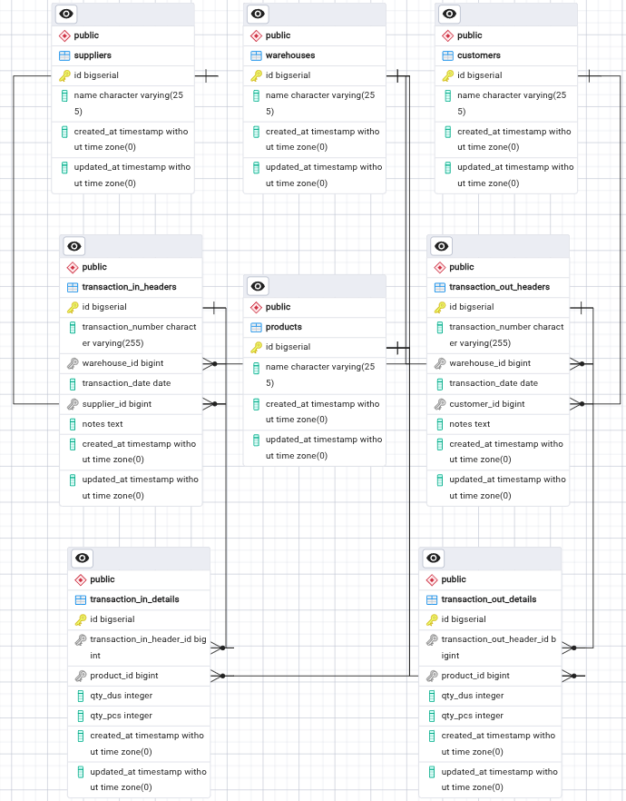

# Inventory Management System

Sistem inventaris berbasis web untuk mencatat transaksi barang masuk, barang keluar, dan memantau stok barang secara realtime. Dibangun dengan Laravel, React (Inertia.js), Tailwind CSS, dan diakses publik melalui Cloudflare Tunnel.

---

## Tech Stack

* Backend: Laravel 12 (PHP 8.5)
* Frontend: React, Inertia.js, TypeScript
* UI Styling: Tailwind CSS, Shadcn UI, Lucide Icons
* Database: PostgreSQL
* Deployment: Debian Server Local + Cloudflare Tunnel (cloudflared)

---

## Entity Relationship Diagram (ERD)

---

## Fitur Utama

* Dashboard: Ringkasan navigasi cepat untuk akses ke semua halaman utama.
* Barang Masuk: Pencatatan penerimaan barang dari supplier dengan rincian jumlah Dus dan Pcs.
* Barang Keluar: Pencatatan pengeluaran barang ke customer dengan rincian jumlah Dus dan Pcs.
* Laporan Stok: Perhitungan stok fisik aktual otomatis (Total Masuk - Total Keluar) per gudang.
* Hak Akses (Role):
  * Admin: Akses penuh untuk melihat, menambah, mengedit, dan menghapus data.
  * Staff: Hanya bisa melihat data dan menambah transaksi harian.

---

## Struktur Rute & Hak Akses (Routes)

* Public:
  * `GET /` : Landing page awal (`welcome`)
* Authenticated (Admin & Staff):
  * `GET /dashboard` : Halaman utama dashboard
  * `GET /stock-report` : Laporan stok persediaan
  * `GET, POST /transaction-in` : Lihat daftar & tambah barang masuk
  * `GET, POST /transaction-out` : Lihat daftar & tambah barang keluar
* Restricted (Khusus Middleware `role:admin`):
  * `GET, PUT, DELETE /transaction-in/{id}` : Edit, update, dan hapus barang masuk
  * `GET, PUT, DELETE /transaction-out/{id}` : Edit, update, dan hapus barang keluar
 
---

## Struktur Folder Utama

* `app/Http/Controllers/` : Logika bisnis (`TransactionInController`, `TransactionOutController`, `StockReportController`)
* `app/Http/Middleware/RoleMiddleware.php` : Proteksi hak akses role Admin & Staff
* `database/seeders/UserSeeder.php` : Seeder pembuatan akun pengujian
* `resources/js/Pages/` : Tampilan frontend React/Inertia
  * `TransactionIn/` : Halaman Index, Create, Edit barang masuk
  * `TransactionOut/` : Halaman Index, Create, Edit barang keluar
  * `StockReport/` : Halaman laporan stok
  * `Dashboard.tsx` & `Welcome.tsx` : Halaman navigasi & landing page

---

## Akun Default Testing

* Admin: `admin@admin.com` | Password: `password123`
* Staff: `staff@admin.com` | Password: `password123`

---

Dapat Diakses di https://private-build-slightly-oxide.trycloudflare.com/ (Untuk Sementara)
